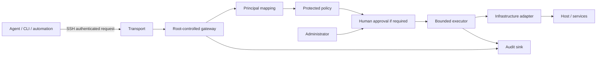
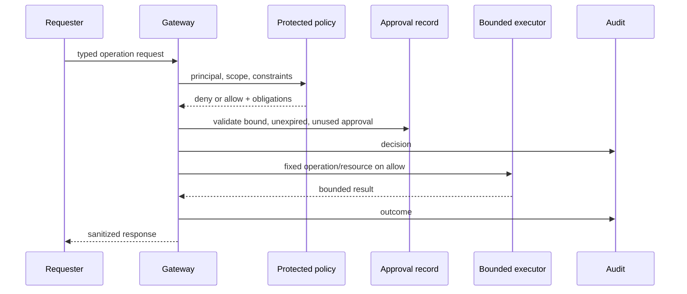

# Architecture overview

**Status:** Target architecture proposal; current implementation is narrower.

The client is untrusted. SSH proves control of a transport credential; it does
not establish role or permission. A trusted gateway maps verified transport
identity to a principal, evaluates protected policy, validates required
approval, calls a bounded adapter, and records decisions and outcomes.
Authentication, principal mapping, authorization, approval, and execution are
distinct checks.

The current tree contains a `src/homelab_ops/` Python package, operator and
installer scripts, a bounded inventory wrapper, client convenience validation,
schema 1 and schema 2 policy paths, and standard-library tests. Gateway
requests remain narrowly `status` or `restart jellyfin`. Status delegates to
the inventory wrapper. Restart consumes a one-use approval, validates policy
and live container identity, then restarts the verified ID. Local schema 2
policy evaluation exists, but installed schema 2 behavior is not verified.
This is not yet the complete product workflow or a general adapter API.

Invariants: no caller command/path/environment reaches privileged execution;
adapter calls follow policy and approval; policy failure denies; promotion
inputs are requester-inaccessible; each host remains authoritative even in a
future fleet. See focused documents for [trust](trust-boundaries.md),
[identity](identity.md), [policy](policy-engine.md),
[approval](approval-system.md), [execution](execution-engine.md),
[transport](transport.md), [audit](audit.md), [threats](threat-model.md),
[configuration](configuration.md), [packaging](packaging.md),
[recovery](recovery.md), [resource model](resource-model.md),
[adapters](adapters.md), and [migration](migration.md).
