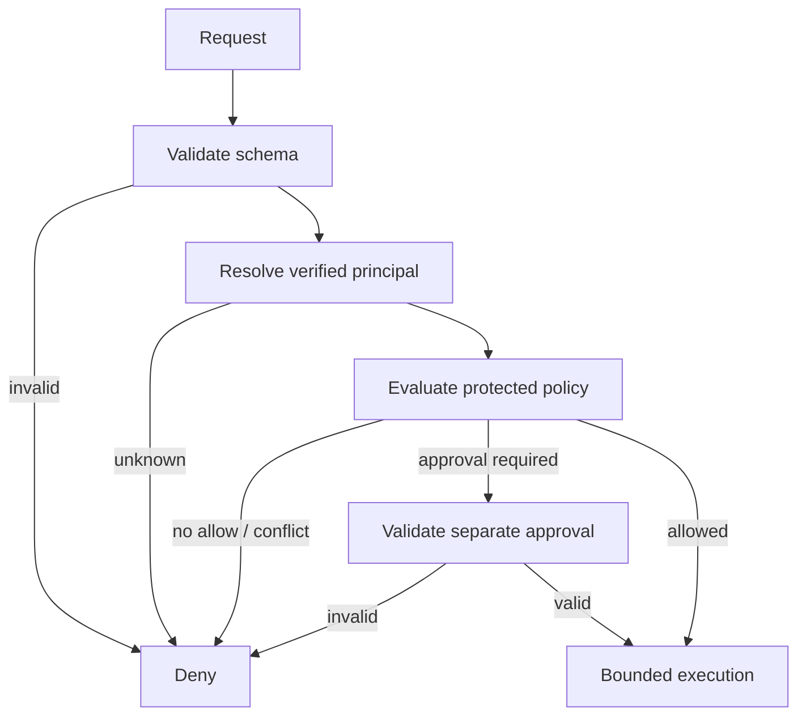

# Authorization and policy engine

Current gateway behavior combines exact request parsing, a root-protected JSON
mapping for one restart target, operation checks, and a client-side convenience
allowlist. Server policy is authoritative. Schema 1 is specific to Phase 2;
there is no reusable generalized policy engine.

Target evaluation is deterministic and default-deny. Inputs: verified
principal, operation ID, typed resource, constraints, context, and policy
revision. Output: allow/deny, obligations (including human approval), stable
reason code, and policy revision for audit. Adapters cannot bypass the result.

Phase 3 implements schema 2 locally: exact Unix-account-to-principal mapping,
role composition, exact operation/resource permissions, explicit-deny
precedence, and approval obligations. Unknown mappings and missing matches
deny. The target runtime has one canonical schema: schema 2. The schema 1
reader currently present in local code is transitional and under review for
removal; use offline conversion and decision comparison for migration rather
than retaining two runtime evaluators. The current schema 2 scope does not
include wildcards, arbitrary constraints, policy update interfaces, or
per-credential identity; the latter belongs to Phase 4. Policy updates remain
administrator-controlled and require protected promotion. Local canary
verification is documented, but Phase 3 release evidence is incomplete.

